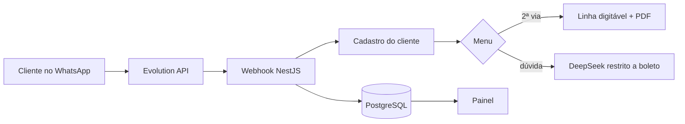

# Bot de Segunda Via de Boleto

Chatbot de WhatsApp que cadastra o cliente, emite a segunda via do boleto (texto + PDF) e usa IA restrita ao tema, com painel para acompanhar as conversas.

    

> Projeto real. Este repositório é uma **cópia de portfólio**: segredos, servidores e nomes de empresas foram removidos ou trocados pelo nome fictício "Natela".

## Sumário

1. [O que o projeto faz](#1-o-que-o-projeto-faz)
2. [Instalação e requisitos](#2-instalação-e-requisitos)
3. [Como rodar e usar](#3-como-rodar-e-usar)
4. [Demo visual](#4-demo-visual)
5. [Suporte e ajuda](#5-suporte-e-ajuda)
6. [Contribuição e manutenção](#6-contribuição-e-manutenção)
7. [Licença e status](#7-licença-e-status)

## 1. O que o projeto faz

**O que resolve:** Pedidos de segunda via de boleto lotam o WhatsApp do financeiro com a mesma pergunta o dia todo.

**Como resolve:** Um bot que atende pelo WhatsApp com menu, cadastra o cliente, gera a segunda via na hora e responde dúvidas com IA limitada ao assunto boleto — recusando qualquer outro tema e sem inventar dados.

**Para quem é:** Empresas com carteira de boletos que atendem clientes pelo WhatsApp.

**Por que importa:** Atendimento imediato para a dúvida mais comum, e o financeiro acompanha tudo pelo painel.

### Principais benefícios

| Segunda via na hora | IA que não sai do assunto | Painel das conversas |
|---|---|---|

### Funcionalidades

- Webhook da Evolution API com token
- Cadastro do cliente (nome + CPF/CNPJ) no PostgreSQL
- Menu com botões interativos ou opções numeradas
- Segunda via simulada: linha digitável + PDF gerado na hora (pdfkit)
- Respostas livres com DeepSeek restritas a boleto
- Painel com login: conversas, contatos, atendentes, campanhas e templates
- Simulador de webhook para testar sem WhatsApp

## 2. Instalação e requisitos

### Pré-requisitos

| Ferramenta | Versão |
|---|---|
| Node.js | 20 |
| npm | 10+ |
| PostgreSQL | 16 |
| Evolution API | v2 |

### Instalação

```bash
git clone https://github.com/jhonatancamargo121/bot-boleto-whatsapp.git
cd bot-boleto-whatsapp
npm install
cp .env.example .env
```

### Variáveis de ambiente

| Variável | Para que serve |
|---|---|
| `DATABASE_URL` | Banco PostgreSQL |
| `EVOLUTION_API_URL / EVOLUTION_API_KEY / EVOLUTION_INSTANCE` | Canal de WhatsApp |
| `WEBHOOK_TOKEN` | Protege o webhook |
| `DEEPSEEK_API_KEY` | IA restrita ao tema |
| `PAINEL_USUARIO / PAINEL_SENHA` | Login do painel |

A lista completa, com comentários, está no `.env.example`. Nenhum valor real é versionado.

## 3. Como rodar e usar

### Quick start

```bash
docker compose up -d
npm run start:dev
```

O painel fica em `/painel`.

### Exemplo de uso

Requisição:

```bash
curl -I http://localhost:3000/painel
```

Resposta esperada:

```text
HTTP/1.1 303 See Other (redireciona para o login do painel)
```

## 4. Demo visual

Fluxo principal:



> Prints e GIF com dados fictícios estão no roadmap. Para ver o sistema rodando, siga o [Quick start](#3-como-rodar-e-usar).

## 5. Suporte e ajuda

- **Documentação:**
  - [Detalhes técnicos](docs/DETALHES.md)
- **Issues:** abra uma [issue](https://github.com/jhonatancamargo121/bot-boleto-whatsapp/issues) para reportar problemas ou sugerir melhorias.
- **Discussions:** dúvidas gerais em [Discussions](https://github.com/jhonatancamargo121/bot-boleto-whatsapp/discussions).
- **Contato:** pelo perfil [@jhonatancamargo121](https://github.com/jhonatancamargo121)

## 6. Contribuição e manutenção

### Como contribuir

1. Faça um **fork** do repositório
2. Crie uma **branch** a partir da `main` (`git checkout -b feat/minha-melhoria`)
3. Abra um **Pull Request** descrevendo o que mudou e por quê

### Padrões

- Commits no padrão [Conventional Commits](https://www.conventionalcommits.org/pt-br/) (`feat:`, `fix:`, `docs:`…)
- Lint e formatação passando antes do PR
- Testes rodando antes do PR

### Testes

Este projeto ainda não tem suíte automatizada; ela está no roadmap.

### Mantenedores

| | |
|---|---|
| **Jhonatan Camargo** ([@jhonatancamargo121](https://github.com/jhonatancamargo121)) | Mantenedor |

## 7. Licença e status

### Licença

Código proprietário, publicado para fins de portfólio. Todos os direitos reservados; veja o arquivo [LICENSE](LICENSE).

### Status


### Próximos passos

- [ ] Integração com o sistema financeiro real
- [ ] Testes automatizados do fluxo do bot
